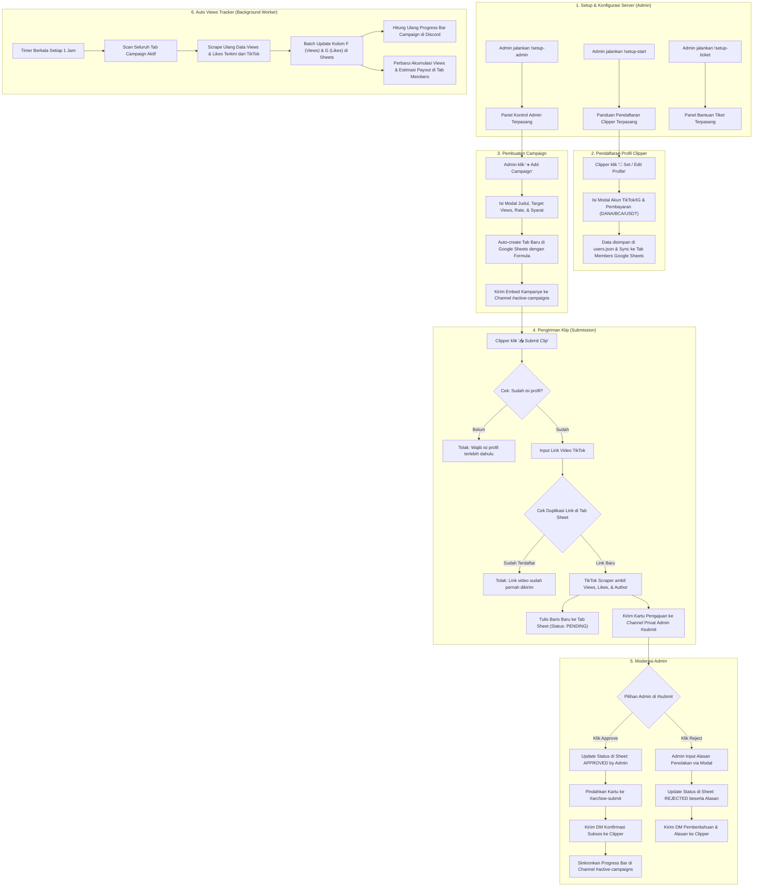

# 📚 Dokumentasi Lengkap Sistem Bot Clipping Discord (v1.3.0)

Dokumentasi ini menjelaskan secara komprehensif seluruh arsitektur, alur kerja (workflow), konfigurasi, peran pengguna, serta integrasi eksternal (Google Sheets & TikTok Scraper) pada bot **Rune Viral / Bot Clipping**.

> [!NOTE]
> **Pembaruan v1.3.0**: Menambahkan validasi otomatis gerbang submission (*gatekeeper*) untuk Tanggal Upload Video TikTok (`createTime` $\ge$ Campaign Start Date) dan Validasi Audio Resmi Kampanye (`musicInfo.id` / sound URL) untuk mencegah kecurangan klip lama dan penyimpangan audio algoritma.

---

## 📑 Daftar Isi
1. [Gambaran Umum Sistem](#-gambaran-umum-sistem)
2. [Struktur File & Direktori](#-struktur-file--direktori)
3. [Arsitektur & Integrasi](#-arsitektur--integrasi)
4. [Alur Kerja Lengkap (End-to-End Workflow)](#-alur-kerja-lengkap-end-to-end-workflow)
   - [Diagram Alur (Mermaid Flowchart)](#diagram-alur-sistem)
   - [Fase 1: Setup & Konfigurasi Server (Admin)](#fase-1-setup--konfigurasi-server-admin)
   - [Fase 2: Pendaftaran Profil Clipper](#fase-2-pendaftaran-profil-clipper)
   - [Fase 3: Pembuatan & Publikasi Campaign](#fase-3-pembuatan--publikasi-campaign)
   - [Fase 4: Pengiriman Klip (Clip Submission)](#fase-4-pengiriman-klip-clip-submission)
   - [Fase 5: Moderasi & Approval Admin](#fase-5-moderasi--approval-admin)
   - [Fase 6: Background Auto-Tracking Views](#fase-6-background-auto-tracking-views)
   - [Fase 7: Layanan Tiket Bantuan & Pelacakan Undangan](#fase-7-layanan-tiket-bantuan--pelacakan-undangan)
5. [Struktur & Skema Data Google Sheets](#-struktur--skema-data-google-sheets)
6. [Variabel Lingkungan (.env)](#-variabel-lingkungan-env)
7. [Daftar Command & Interaksi UI](#-daftar-command--interaksi-ui)

---

## 📌 Gambaran Umum Sistem

Bot ini dirancang untuk memfasilitasi dan mengotomatiskan program **TikTok Clipping Campaign**:
* **Admin / Manajer Brand**: Membuat kampanye promosi, menetapkan target total views & pay rate, memoderasi video yang masuk, serta memantau progres secara terpusat di Google Sheets.
* **Clipper / Kreator Konten**: Mendaftarkan akun media sosial dan informasi pembayaran, mengirimkan link video TikTok, dan memantau status persetujuan serta estimasi pendapatan melalui dasbor pribadi.
* **Sistem Otomasi**: Mengambil data metrics TikTok (views, likes, engagement rate) secara langsung tanpa input manual, menyinkronkan data ke Google Sheets, dan memperbarui grafik progres kampanye secara berkala tiap jam.

---

## 📁 Struktur File & Direktori

```text
bot-clipping_1.2.2/
├── config/                     # Folder konfigurasi tambahan
├── data/
│   └── users.json              # Penyimpanan lokal profil clipper (ID, akun TikTok/IG, metode pembayaran)
├── embeds/
│   ├── adminEmbed.js           # Template visual embed dashboard admin
│   └── rulesEmbed.js           # Template visual embed peraturan server
├── handlers/
│   ├── adminHandler.js         # Logika panel admin (pembuatan & penutupan campaign)
│   ├── commandHandler.js       # Penanganan perintah prefix (!setup-admin, !setup-start, !setup-ticket)
│   ├── inviteHandler.js        # Pelacakan link undangan Discord & pencatat reward inviter
│   ├── profileHandler.js       # Modal & penyimpanan profil clipper serta dashboard pribadi
│   ├── submitHandler.js        # Validasi form submission, deduplikasi link, & pengiriman kartu review
│   ├── ticketHandler.js        # Pembuatan, manajemen hak akses, dan penutupan channel tiket privat
│   ├── viewsTracker.js         # Cron job sinkronisasi views TikTok ke Google Sheets per jam
│   └── welcomeHandler.js       # Penanganan member baru yang bergabung ke server
├── utils/
│   ├── progressBar.js          # Generator baris visual progress bar teks [▓▓░░░]
│   ├── sheetsHelper.js         # Wrapper Google Sheets API v4 (buat tab, update data, kalkulasi formula)
│   ├── stickyHandler.js        # Pengelolaan sticky message di channel tertentu
│   └── tiktokScraper.js        # Pengambil metrik video TikTok (views, likes, author, skor engagement)
├── .env                        # Kredensial rahasia (Token Bot, Channel ID, Spreadsheet ID)
├── .gitignore                  # Berkas yang dikecualikan dari Git repository
├── credentials.json            # Google Service Account key (autentikasi Google Sheets)
├── discloud.config             # Berkas konfigurasi deploy ke hosting Discloud
├── google-key.json             # Salinan kunci kredensial Google Service Account
├── index.js                    # Titik masuk utama aplikasi (entry point) & event router Discord
├── package.json                # Daftar dependensi modul Node.js
└── DOCUMENTATION.md            # Dokumentasi sistem ini
```

---

## ⚙️ Arsitektur & Integrasi

```
+-------------------------------------------------------------+
|                      DISCORD INTERACTION                    |
|   (Buttons, Modals, Slash/Prefix Commands, Dynamic Embeds)  |
+------------------------------+------------------------------+
                               |
                               v
                     +-------------------+
                     |     index.js      |
                     |  (Event Router)   |
                     +---------+---------+
                               |
         +---------------------+---------------------+
         |                     |                     |
         v                     v                     v
+------------------+  +------------------+  +------------------+
| Profile Handler  |  |  Submit Handler  |  |  Views Tracker   |
| (data/users.json)|  | (Review & Mod)   |  | (Hourly Worker)  |
+--------+---------+  +--------+---------+  +--------+---------+
         |                     |                     |
         |                     v                     |
         |            +------------------+           |
         |            |  TikTok Scraper  |           |
         |            | (Live Video Data)|           |
         |            +--------+---------+           |
         |                     |                     |
         +---------------------+---------------------+
                               |
                               v
               +-------------------------------+
               |    Google Sheets API (v4)     |
               | (Campaign Tabs, Members, Logs)|
               +-------------------------------+
```

---

## 🚀 Alur Kerja Lengkap (End-to-End Workflow)

### Diagram Alur Sistem



---

### Fase 1: Setup & Konfigurasi Server (Admin)
* Admin dengan permission `ManageMessages` mengirim command prefix di channel yang ditentukan:
  * `!setup-admin`: Menghasilkan embed panel kontrol admin dengan tombol `➕ Add Campaign` dan `⛔ Close Campaign`.
  * `!setup-start`: Menghasilkan panduan awal bagi clipper beserta tombol `👤 Set / Edit Profile`.
  * `!setup-ticket`: Menghasilkan panel pembukaan tiket bantuan bagi member yang memerlukan kendala pribadi.

---

### Fase 2: Pendaftaran Profil Clipper
1. Clipper menekan tombol `👤 Set / Edit Profile`.
2. Discord menampilkan modal formulir:
   * **TikTok / IG Username**: Hingga 3 nama akun (dipisahkan koma).
   * **Payment Details**: Format bebas (contoh: *DANA 08123456789*, *BCA 123456 a.n Budi*, *USDT TRC20: T...*).
3. Setelah dikirim:
   * Profil disimpan di [users.json](file:///d:/version%20Bot/bot-clipping_1.2.2/data/users.json).
   * Bot menyinkronkan profil ke tab `Members` di Google Sheets (Kolom A-E).
   * Jika user masuk melalui undangan member lain, sistem menghitung validasi invite ke pengundangnya.

---

### Fase 3: Pembuatan & Publikasi Campaign
1. Admin menekan tombol `➕ Add Campaign` pada panel admin.
2. Admin mengisi formulir:
   * **Campaign Title**: Nama event atau brand.
   * **Target Views**: Target kumulatif views (contoh: `1000000` atau `1M`).
   * **Pay Rate Details**: Nilai tarif (contoh: `$10 per 10k views`).
   * **Thumbnail Image URL**: Gambar banner pendukung.
   * **Requirements & Details**: Aturan kliping, hashtag wajib, dan sound yang harus digunakan.
3. Bot mengeksekusi integrasi Google Sheets:
   * Membuat tab baru dengan nama judul campaign.
   * Menulis metadata (Target Views di cell `B3`, Pay Rate di cell `B4`).
   * Mengisi struktur kolom tabel submission lengkap dengan header dan styling.
4. Bot mempublikasikan kartu kampanye ke channel `#active-campaigns` lengkap dengan:
   * Tampilan visual progress bar target views `[░░░░░░░░░░] 0% (0 / 1,000,000 Views)`.
   * Tombol aksi: `📥 Submit Clip` (terikat ke ID tab sheet terkait) dan `📊 My Dashboard`.

---

### Fase 4: Pengiriman Klip (Clip Submission)
1. Clipper menekan tombol `📥 Submit Clip` pada pesan campaign.
2. Sistem mengecek status kelengkapan profil:
   * Jika belum terdaftar, bot menolak dan mengarahkan pengguna untuk mendaftar lebih dulu.
3. Pengguna menginput URL video TikTok.
4. Sistem memeriksa apakah URL tersebut sudah pernah tercatat pada tab campaign tersebut untuk mencegah pengiriman ganda.
5. `tiktokScraper.js` mengekstrak data metrik langsung dari TikTok:
   * Views & Likes terkini.
   * Skor keterlibatan (*Engagement Rate*).
   * Username pemilik konten asli.
6. Data dicatat ke baris baru spreadsheet dengan status `PENDING` dan formula otomatis kalkulasi payout (`=INDIRECT("F"&ROW())*B$4`).
7. Kartu pengajuan dikirimkan ke channel admin `#submit` dengan opsi tombol **🟢 Approve** dan **🔴 Reject**.

---

### Fase 5: Moderasi & Approval Admin
Admin melakukan pengecekan kepatuhan konten terhadap syarat campaign:
* **Jika Disetujui (Approve)**:
  1. Status pengajuan di spreadsheet berubah menjadi `APPROVED by [AdminTag]`.
  2. Kartu interaksi dipindahkan/dicatat ke channel `#archive-submit`.
  3. Kartu di channel `#submit` dibersihkan.
  4. Bot mengirim pesan DM otomatis ke clipper yang bersangkutan.
  5. Progress bar pada kartu kampanye di `#active-campaigns` diperbarui otomatis merefleksikan total views yang disetujui.
* **Jika Ditolak (Reject)**:
  1. Muncul modal dialog agar admin memasukkan alasan penolakan.
  2. Status di spreadsheet berubah menjadi `REJECTED` dan alasan ditulis pada Kolom I.
  3. Bot mengirim pesan DM ke clipper menginformasikan alasan penolakan.

---

### Fase 6: Background Auto-Tracking Views
Bot menjalankan worker otomatis di latar belakang dengan interval **setiap 1 jam**:
1. Menemukan semua tab campaign aktif (mengecualikan tab sistem `Members`, `Sheet1`, `Invites`).
2. Mengumpulkan seluruh URL TikTok yang terdaftar pada baris 7 ke atas.
3. Melakukan pengambilan metrik terbaru secara bertahap dengan jeda waktu aman (*rate-limiting delay*).
4. Melakukan *batch update* nilai Views (Kolom F) dan Likes (Kolom G) di spreadsheet.
5. Menghitung kembali total views yang sudah disetujui dan memperbarui progress bar embed di channel `#active-campaigns`.
6. Melakukan rekalkulasi statistik member di tab `Members` (total video terkirim, total views, dan total akumulasi pembayaran).

---

### Fase 7: Layanan Tiket Bantuan & Pelacakan Undangan
* **Sistem Tiket ([ticketHandler.js](file:///d:/version%20Bot/bot-clipping_1.2.2/handlers/ticketHandler.js))**:
  * Member klik `🎫 Open Ticket`.
  * Sistem membuat channel teks baru di bawah kategori `TICKETS` dengan permission khusus hanya untuk user yang membuka tiket dan staff.
  * Terdapat proteksi: 1 user hanya boleh memiliki 1 tiket aktif pada waktu yang sama.
  * Tombol `🔒 Close Ticket` tersedia di dalam channel untuk menutup dan menghapus tiket.
* **Pelacakan Undangan ([inviteHandler.js](file:///d:/version%20Bot/bot-clipping_1.2.2/handlers/inviteHandler.js))**:
  * Bot memetakan daftar kode invite saat startup.
  * Setiap ada member baru masuk, bot membandingkan jumlah penggunaan kode invite untuk mendeteksi siapa pengundangnya, lalu mencatatnya ke Google Sheets.

---

### Fase 8: Audit & Pembersihan Tab Kampanye Lama ([audit-cli.js](file:///d:/version%20Bot/bot-clipping_1.3.0/audit-cli.js))
Alat CLI mandiri interaktif untuk membersihkan dan memvalidasi riwayat kampanye terdahulu (*legacy campaign tabs*):
* **Perlindungan Layout**: Hanya memeriksa dan mengubah Baris 7 ke atas (data submission), sama sekali tidak menimpa baris metadata 1–6.
* **Pengecekan Otomatis**:
  1. Kecocokan ID audio resmi kampanye.
  2. Waktu upload video terhadap tanggal mulai kampanye.
  3. Deteksi video privat/terhapus.
* **Pembaruan Sheet Otomatis**: Memperbarui status ke `REJECTED (Auto-Audit)` atau `APPROVED`, memperbarui views/likes live, serta mencatat alasan penolakan.
* **Fitur Resumability**: Menyimpan checkpoint lokal di `audit-progress.json` sehingga proses audit dapat dilanjutkan kembali jika terputus.
* **Laporan Finansial**: Menghitung estimasi total views curang yang dipangkas dan total anggaran dana (*budget saved* USD) yang diselamatkan.
* **Cara Eksekusi**: `npm run audit` atau `node audit-cli.js`.

---

## 📊 Struktur & Skema Data Google Sheets

### 1. Tab Campaign (Dibuat otomatis per campaign)
* **Metadata Header (Baris 1 - 6)**:
  * Cell `A1 / B1`: `Campaign Title` | Nama judul kampanye
  * Cell `A2 / B2`: `Approved Views` | Formula `=SUMIF(INDIRECT("L8:L1000"), "*APPROVED*", INDIRECT("F8:F1000"))`
  * Cell `A3 / B3`: `TARGET VIEWS` | Angka target views kumulatif (contoh: `1000000`)
  * Cell `A4 / B4`: `RATE PER VIEW` | Nilai pengali per view (contoh: `0.001`)
  * Cell `A5 / B5`: `START DATE` | ISO 8601 Timestamp UTC (contoh: `2026-10-21T00:00:00.000Z`) [NEW v1.3.0]
  * Cell `A6 / B6`: `MUSIC ID` | ID Numerik / Link Sound TikTok Resmi [NEW v1.3.0]
* **Tabel Pengajuan (Mulai Baris 8 ke bawah - 13 Kolom)**:
  * `Col A`: Submission ID (contoh: `SUB-123456`)
  * `Col B`: User Discord ID
  * `Col C`: User Discord Tag / Username
  * `Col D`: Platform (`TikTok`)
  * `Col E`: Link Video TikTok
  * `Col F`: Total Views (diupdate berkala oleh `viewsTracker.js`)
  * `Col G`: Total Likes (diupdate berkala oleh `viewsTracker.js`)
  * `Col H`: Payout Formula (`=INDIRECT("F"&ROW())*B$4`)
  * `Col I`: VT Post Date (Extracted createTime format ISO/UTC) [NEW v1.3.0]
  * `Col J`: Music Detected (Extracted musicInfo.id & title) [NEW v1.3.0]
  * `Col K`: Rejection Notes (Alasan penolakan oleh Admin)
  * `Col L`: Status (`PENDING`, `APPROVED by ...`, `REJECTED`)
  * `Col M`: Submitted At (Timestamp pengajuan video)

### 2. Tab `Members`
* Menyimpan rekap seluruh member yang terdaftar:
  * Discord ID & Username
  * Daftar Akun Media Sosial
  * Detail Metode Pembayaran
  * Total Submissions
  * Total Approved Views
  * Total Estimasi Pendapatan

### 3. Tab `Invites`
* Mencatat data referensi undangan member baru beserta status verifikasi profil mereka.

---

## 🔑 Variabel Lingkungan (.env)

Pastikan file `.env` diisi dengan konfigurasi yang sesuai:

| Variabel | Deskripsi |
| :--- | :--- |
| `TOKEN` / `BOT_TOKEN` | Token Bot Discord dari Developer Portal |
| `ACTIVE_CAMPAIGNS_CHANNEL_ID` | ID Channel tempat posting kartu campaign publik |
| `SUBMIT_ADMIN_CHANNEL_ID` | ID Channel admin tempat verifikasi submission masuk |
| `ARCHIVE_SUBMIT_CHANNEL_ID` | ID Channel arsip pengajuan yang telah diapprove |
| `TICKET_CATEGORY_ID` | ID Kategori tempat channel tiket dibuat |
| `GOOGLE_SPREADSHEET_ID` | ID Master Spreadsheet Google Sheets |
| `ADMIN_ROLE_ID` | ID Role staff/admin yang memiliki akses moderasi |

---

## 🎮 Daftar Command & Interaksi UI

| Pemicu (Trigger) | Tipe | Ditujukan Untuk | Fungsi |
| :--- | :--- | :--- | :--- |
| `!setup-admin` | Prefix Message | Admin | Memunculkan panel pembuatan/penutupan campaign |
| `!setup-start` | Prefix Message | Admin | Memunculkan petunjuk & tombol setup profile member |
| `!setup-ticket` | Prefix Message | Admin | Memunculkan panel pembukaan tiket bantuan |
| `btn_open_profile_setup` | Button | Member | Membuka modal pendaftaran akun & pembayaran |
| `btn_open_my_dashboard` | Button | Member | Membuka kartu dasbor ringkasan statistik pribadi |
| `submit_clip_btn_<tab>` | Button | Member | Membuka formulir pengiriman link TikTok ke campaign terkait |
| `approve_sub_...` | Button | Admin | Menyetujui submission video dan memperbarui data di sheet |
| `reject_sub_...` | Button | Admin | Membuka modal input alasan penolakan video |
| `btn_open_ticket` | Button | Member | Membuat channel tiket privat baru |
| `btn_close_ticket` | Button | Member/Admin | Menutup dan menghapus channel tiket |
